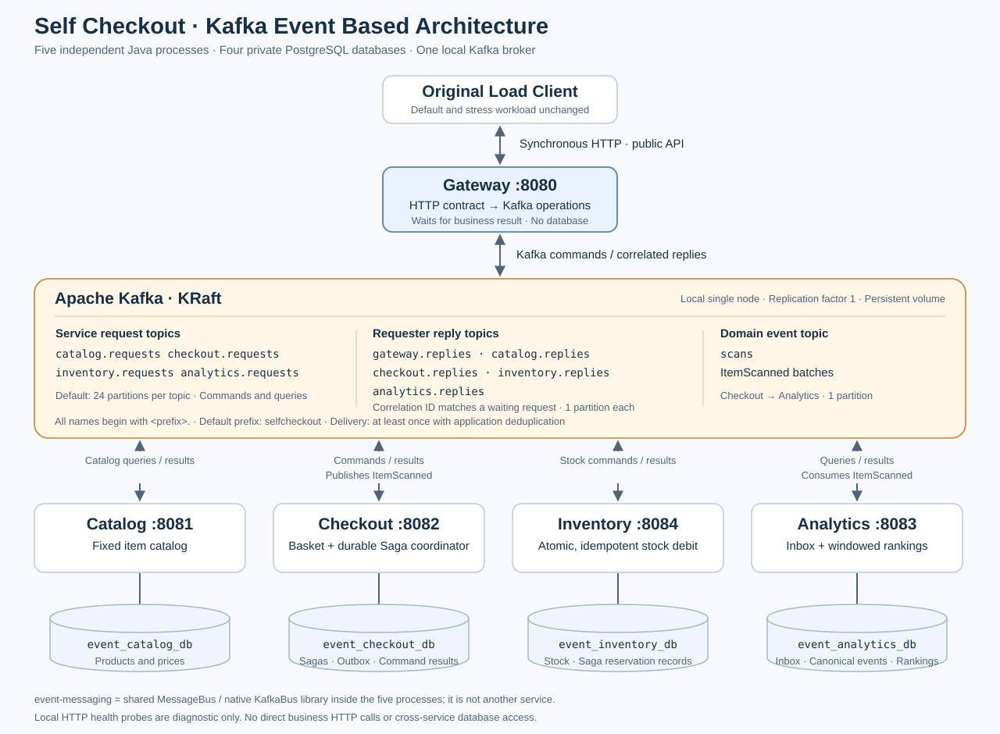

# Self Checkout — Kafka Event Based Architecture

本版本在 `microservices-server` 的基础上保留 Catalog、Checkout、Inventory、Analytics 和 Gateway 五个独立进程。**所有服务间的业务通信都经过 Kafka**，包括 Gateway 的命令/查询、Checkout 的目录读取和库存协调，以及扫描事件。Load Client 仍通过同步 HTTP 访问 Gateway，遵守原来的 [OpenAPI 合同](../spec/self-checkout-openapi.yaml)。



完整的拓扑、消息清单和流程图见 [architecture.md](docs/architecture.md)。`event-messaging` 是五个进程使用的共享消息库，封装原生 Apache Kafka Java clients；它没有数据库，也不是第六个微服务。本项目没有使用 Spring Kafka。

## 服务与数据边界

| 进程 | 默认 HTTP 端口 | 私有数据库示例 | 职责 |
| --- | --- | --- | --- |
| Gateway | 8080 | 无 | 同步 HTTP 入口；发送 Kafka 请求并等待业务结果 |
| Catalog | 8081 | `event_catalog_db` | 商品目录；响应 `GET_CATALOG` |
| Checkout | 8082 | `event_checkout_db` | 购物篮、收据、持久化 Saga、扫描 outbox、命令去重 |
| Analytics | 8083 | `event_analytics_db` | 扫描 inbox、事件序列、滑动窗口和排名 |
| Inventory | 8084 | `event_inventory_db` | 库存、幂等库存操作和扣减记录 |

各服务只访问自己的数据库。业务服务保留的 HTTP controllers 供本地诊断和兼容已有测试使用；运行中的服务不会通过这些接口调用彼此。启动脚本的 `/health` 探测属于本地运维检查。Gateway 不公开 `/internal/**`，也不直接转发到任何业务服务的 HTTP 端口。

## 通信与正确性

- **命令和查询**：Gateway 将原 HTTP 操作映射为 Kafka 请求，在关联的回复到达后返回相同状态码和 JSON。Checkout 使用相同机制读取 Catalog 快照、向 Inventory 发送库存命令。请求使用独立关联 ID，交易和 Saga ID 用作相关操作的分区键。
- **命令持久化**：START 通过一条自动提交的 PostgreSQL SQL 保存购物篮和可重放的命令结果。SCAN 默认交给 `ScanWriter`，将已排队的最多 64 个不同购物篮、不同命令 ID 合并为一条原子 SQL，同时写入各自的明细、总额、outbox 和去重结果。队列容量为 512，不额外等待凑批；每个调用只在自己的写入持久提交后获得成功。找不到或已关闭的购物篮分别返回 404/409，不影响有效购物篮；整批约束失败时，使用原命令 ID 逐条重试，保持幂等。单条路径与批量路径都保留命令 ID 唯一约束及并发重放保护，详见 [ADR 0004](docs/adr/0004-durable-batched-scans.md)。
- **消息编码**：请求/回复使用版本化 Kafka headers 传递关联 ID 等元数据，消息内容直接保留业务 JSON，减少重复转义和编解码。读取端兼容旧 JSON envelope；旧请求仍收到旧格式回复，详见 [ADR 0005](docs/adr/0005-opaque-kafka-payloads.md)。
- **扫描事件**：后台将 `ItemScanned` 事件批次发布到 `<prefix>.scans`。获得 broker 确认后标记 outbox 已发布。Analytics 用事件 UUID 在自己的 inbox 去重，然后生成规范事件序列与排名。扫描成功无需等待 Analytics。
- **结账 Saga**：Checkout 是持久化协调者，冻结购物篮，经 Kafka 请求 Inventory 原子扣减整篮库存，再持久化本地完成状态与收据。常规成功路径中库存扣减即确认；兼容恢复旧 `COMMITTING` 状态。拒绝时执行取消并恢复购物篮；未知结果保留同一个 Saga ID 重试。没有跨库事务，也不声称纯事件编舞。
- **同步完成**：完成接口返回成功之前，Inventory 扣减和 Checkout 完成状态必须都已持久化。收到 broker 发布确认不等于业务完成。
- **分析查询**：Gateway 先通过 Kafka 取得 Checkout 的持久化扫描计数，再要求 Analytics 等待该检查点及应发布窗口。超过等待上限时明确失败，避免把陈旧排名当成已经追平的结果。

Kafka 与数据库之间没有分布式原子提交。消息可能重投；命令结果、Saga ID 和 inbox 事件 ID 提供幂等处理。本项目采用至少一次投递，不声称端到端 exactly-once。架构取舍见 [ADRs](docs/adr/0001-use-kafka.md)。

扫描队列满或服务停止时明确返回 503。已接受的扫描如果等待超过 6 秒，仍可能正在排队或提交；超时表示结果未知，不代表回滚。内部 Kafka 命令 ID 用于 broker 重放去重，原 HTTP API 没有让客户端提交这个 ID 的接口，因此重新发起一次 HTTP 扫描不自动等同于重放同一个命令。

Kafka 网络 poller 与业务处理分开：poller 持续拉取命令，虚拟线程处理数据库操作和跨服务等待，同一个业务 key 的命令在当前进程内串行执行。回复获得 broker 的 `acks=all` 确认后，该命令才算处理完成；每个分区仅提交连续已完成记录构成的 offset 前缀。失败时暂停该分区，等待已派发工作结束，再从失败位置重放；rebalance 后丢弃旧 assignment 的完成通知。故障重放和跨副本切换可能重复或交错执行，不提供故障期间的全局严格顺序。

每个业务服务默认只使用一个命令 poller，新建命令 topic 默认四个分区。JFR 诊断发现，较多消费者加上极短的空 fetch 等待会产生大量短命对象，因此默认恢复 `fetch.max.wait.ms=500`，并显式保留 `fetch.min.bytes=1`。500 毫秒是数据不足时的等待上限；有可返回的消息时，broker 可立即响应，不会为每条消息固定等待 500 毫秒。[Kafka 消费者配置说明](https://kafka.apache.org/42/configuration/consumer-configs/#fetch-max-wait-ms)

## 本地准备与启动

需要 Java 21+、Python 3、PostgreSQL 15+ 与 `psql`，以及 Maven Wrapper 能访问的 Maven 依赖源。Kafka 可以通过 Docker Compose 启动，也可以使用下面的原生 helper。以下命令在 `event-driven-server/` 执行。

先启动单节点 Kafka：

```bash
docker compose up -d --wait
cp .env.example .env
```

Compose 使用 Kafka KRaft 模式、一个本地持久卷和复制因子 1，只适合本次本地作业。它不启动 PostgreSQL。以 PostgreSQL 管理员创建四套独立数据库/用户，并为每个用户设置密码，例如：

```sql
CREATE ROLE event_catalog_user LOGIN PASSWORD 'choose-a-catalog-password';
CREATE DATABASE event_catalog_db OWNER event_catalog_user;
CREATE ROLE event_checkout_user LOGIN PASSWORD 'choose-a-checkout-password';
CREATE DATABASE event_checkout_db OWNER event_checkout_user;
CREATE ROLE event_inventory_user LOGIN PASSWORD 'choose-an-inventory-password';
CREATE DATABASE event_inventory_db OWNER event_inventory_user;
CREATE ROLE event_analytics_user LOGIN PASSWORD 'choose-an-analytics-password';
CREATE DATABASE event_analytics_db OWNER event_analytics_user;
```

编辑 `.env`，填入四套 `*_DB_URL`、`*_DB_USER`、`*_DB_PASSWORD`。使用新的 `event_*` 数据库保留上一版数据。`.env` 被 Git 忽略；脚本按文本解析它，不执行 shell。不要提交密码。

```bash
./run.sh
```

脚本构建模块、初始化各自 schema、仅为空的商品/库存表准备演示数据，然后启动四个业务服务和 Gateway。启动过程会检查端口及就绪状态。已有交易和库存不会因再次启动而重置。日志位于 `target/runtime/`。Ctrl+C 关闭本次启动的五个 Java 进程，数据库与 Kafka 持久数据保留。

```bash
# 已完成构建时：
./run.sh --skip-build
# 使用另一组五个连续的 HTTP 监听端口：
./run.sh --skip-build --base-port=18090
# 仅初始化已有数据库：
python3 scripts/system.py init-db
```

停止 Kafka 使用 `docker compose down`；普通停止保留 Kafka 卷。更改 topic 前缀可以隔离实验消息，但不能替代隔离实验数据库。

### 可选：原生 Kafka

原生模式使用相同的官方 Kafka 4.2.1 发行版。首次提取需要运行中的 Docker 和本地缓存的 `apache/kafka:4.2.1` 镜像；没有缓存时先执行 `docker pull apache/kafka:4.2.1`。helper 只创建一个临时停止状态的容器来复制发行版，随后移除该容器。发行版保存在 `target/kafka-dist/` 后，后续原生启动无需运行 Docker 虚拟机。

```bash
# 终端一：前台运行；Ctrl+C 关闭本次启动的 broker
python3 scripts/kafka-local.py
```

```bash
# 终端二：供基准脚本使用
export KAFKA_BOOTSTRAP_SERVERS=127.0.0.1:19092
# ./run.sh 还会读取 .env；请同时将其中的 KAFKA_BOOTSTRAP_SERVERS 改为此地址。
```

默认 broker/controller 分别监听 `127.0.0.1:19092` / `19093`。数据保存在 `target/native-kafka/data/`，配置和日志在 `target/native-kafka/19092/`。`--distribution`、`--port`、`--data-dir` 可选其他位置；controller 使用 broker 的下一个端口。已有元数据不会重新格式化，数据不会因退出被删除，端口占用时明确失败。helper 直接以 Java 参数列表启动 Kafka，兼容项目路径中的空格。原生与 Compose 都是单节点、复制因子 1，不提供高可用保障；压测需记录实际部署方式与后台负载。

## 主要配置

| 环境变量 | 用途 / 默认值 |
| --- | --- |
| `KAFKA_BOOTSTRAP_SERVERS` | Kafka 地址，默认 `127.0.0.1:9092` |
| `KAFKA_TOPIC_PREFIX` | Topic 命名空间，默认 `selfcheckout` |
| `KAFKA_REQUEST_TIMEOUT_MS` | 一次 Kafka 请求/业务回复的等待预算，默认 `8000` |
| `KAFKA_TOPIC_PARTITIONS` | 新建命令 topic 的分区数；示例与本机验收配置为 `1`，增加消费者副本时可配置更多分区 |
| `KAFKA_CHECKOUT_CONCURRENCY` / `KAFKA_INVENTORY_CONCURRENCY` | 命令网络 poller 数量，各默认 `1`；业务处理使用独立虚拟线程 |
| `KAFKA_CATALOG_CONCURRENCY` / `KAFKA_ANALYTICS_CONCURRENCY` | 命令网络 poller 数量，各默认 `1` |
| `KAFKA_CONSUMER_CONCURRENCY` | 可选的统一并发覆盖值；服务专属设置优先 |
| `KAFKA_FETCH_MAX_WAIT_MS` / `KAFKA_EVENT_FETCH_MAX_WAIT_MS` | 命令/回复与扫描事件的数据不足 fetch 等待上限，各默认 `500` 毫秒；`fetch.min.bytes=1` |
| `KAFKA_COMMAND_POLL_MS` | 命令 poll 的等待上限，默认 `100` 毫秒；可用消息可提前返回 |
| `KAFKA_HEADER_ENVELOPES` | 默认 `true`，请求使用 Kafka 消息头与原业务 JSON，读取端兼容旧格式，回复匹配请求格式；滚动升级说明见 [ADR 0005](docs/adr/0005-opaque-kafka-payloads.md) |
| `KAFKA_PERFORMANCE_LOG` | 累积记录请求确认、排队、业务处理和回复确认等阶段耗时，默认 `false`，诊断时可开启 |
| `ANALYTICS_QUERY_CATCH_UP_MS` | 分析查询等待扫描及窗口追平的上限，默认 `6000` |
| `EVENT_JAVA_OPTS` | 示例与本机验收参数为 `-Xms64m -Xmx256m -XX:TieredStopAtLevel=1`；启动器未设置该变量时回退到 tier 4 |
| `CHECKOUT_INVENTORY_MAX_IN_FLIGHT` | Checkout 同时等待的库存命令上限，默认 `64` |
| `INVENTORY_MAX_IN_FLIGHT` | Inventory 本地数据库操作并发上限，默认 `8` |
| `CHECKOUT_SCAN_BATCHING_ENABLED` | 默认 `true`，将已排队的独立购物篮扫描合批提交；`false` 使用原单条 SQL 路径 |
| `CHECKOUT_SCAN_PERFORMANCE_LOG` | 批大小与 SQL 写入耗时诊断，默认 `false` |

实际部署值以 `.env.example`、启动参数和压测的环境记录为准。Topic 创建参数不会自动修改已有 topic。每个服务的回复 topic 和扫描事件 topic 使用一个分区；Kafka 只保证单个分区内的记录顺序。

Gateway 单独启动示例：

```bash
java -jar gateway/target/gateway-0.0.1-SNAPSHOT.jar --port=8080
```

Gateway 不再接受上一版的 `--catalog-url` 等 HTTP 上游参数。业务结果错误原样返回；Gateway 的消息传输失败为 502，等待超时为 504。

## 验证与作业提交

真实 Kafka 恢复验收可执行 `KAFKA_BOOTSTRAP_SERVERS=127.0.0.1:19092 python3 scripts/test-events.py --temporary-postgres`，它创建并清理测试独占的 PostgreSQL 实例。

```bash
./mvnw package
curl http://localhost:8080/health
curl http://localhost:8080/items
curl 'http://localhost:8080/inventory/low-stock?threshold=1001'
curl 'http://localhost:8080/analytics/popular-items?limit=10'
```

当前代码的 117 项 Java 测试和 4 项脚本安全测试已通过，其中 13 项使用真实 PostgreSQL，验证并发命令去重、批次回滚、独立购物篮结果及跨副本重放；扫描 writer 的测试还覆盖队列满、超时和关闭。真实数据库测试通过 `CHECKOUT_TEST_DB_URL`、`CHECKOUT_TEST_DB_USER`、`CHECKOUT_TEST_DB_PASSWORD` 配置连接，在独立 schema 内运行，测试账号需要创建 schema 的权限；未配置 URL 时会跳过这 13 项。[本轮验证记录](reports/submission/validation.json) 还包含更新后代码的真实 Kafka 集成验收：Analytics 停机追赶、UUID 重放去重、Inventory 停机及 Checkout 重启后的 Saga 恢复。本轮使用测试独占的临时 PostgreSQL 实例进行恢复验证，并确认临时实例与四个数据库均已清理；验证 JAR 哈希与正式负载报告一致。

正式压测使用原始 Load Client，不修改客户端业务逻辑：

```bash
# 先在另一终端运行 python3 scripts/kafka-local.py，并关闭 macOS 低电量模式。
KAFKA_BOOTSTRAP_SERVERS=127.0.0.1:19092 KAFKA_TOPIC_PARTITIONS=1 \
  ./scripts/run-benchmarks.sh --broker-deployment=native --database-servers=separate \
  --java-opts='-Xms64m -Xmx256m -XX:TieredStopAtLevel=1' --publish-submission
```

以上命令是本轮已验收的原生部署配置；其他部署需要重新测量。脚本分别执行默认参数（10 stations / 60 秒）及 `--stations=100 --duration=120`，使用四个测试独占的临时 PostgreSQL 实例与隔离的 Kafka topic 命名空间。正式负载准备 2,000 个 SKU、每 SKU 1,000,000 件起始库存；普通 `run.sh` 的小型演示种子不等同于该数据集。测试账号需具备本地数据库创建/清理能力，可配置 `SAGA_TEST_DB_USER`、`SAGA_TEST_DB_PASSWORD`。它不会重置正常运行的四套数据库。

`--database-locale=C` 是可选的排序规则对照实验，只在基准脚本新建的临时数据库上设置 `LC_COLLATE` / `LC_CTYPE`；默认仍为 `inherited`。普通 `run.sh` 不修改现有数据库的排序规则。对照报告会记录实际 locale，比较时应区分这一部署条件。

`--publish-submission` 只有在两组各 17 项正确性审计通过，且每组的交易数和 TPS 都不低于最近 Microservices 正式报告时才更新提交目录：Default 至少 11,031 笔 / 183.7414278303277 TPS，Stress 至少 31,431 笔 / 261.68575815703423 TPS。比较报告还单独记录更早的用户提供 Service-Based 参考，避免混淆基准。未达标的原始实测结果保留在本轮 `reports/load-*` 目录。

当前正式报告已达标：Default **15,866 笔 / 264.23591 TPS**，Stress **34,625 笔 / 286.39168 TPS**；两项均零错误、各 17 项审计通过。它们来自同一版本、同一配置的一轮完整验收，已核对原始客户端哈希、实测 JAR 哈希和报告字节副本。历史中间结果保存在 `reports/optimization/`，不代表当前提交成绩。

提交清单见 [SUBMISSION.md](SUBMISSION.md)，实测结果和限制见 [PERFORMANCE.md](PERFORMANCE.md)。没有经过本版本实际执行的报告不能作为 Kafka 版本的成绩证据。
