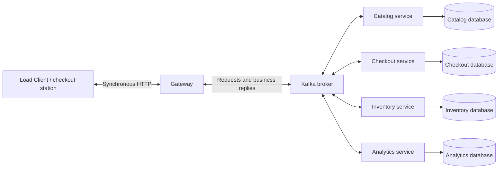
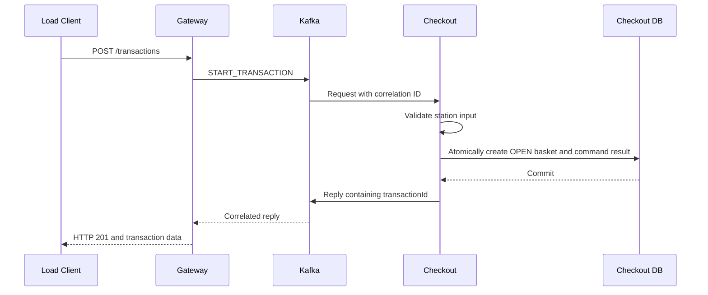
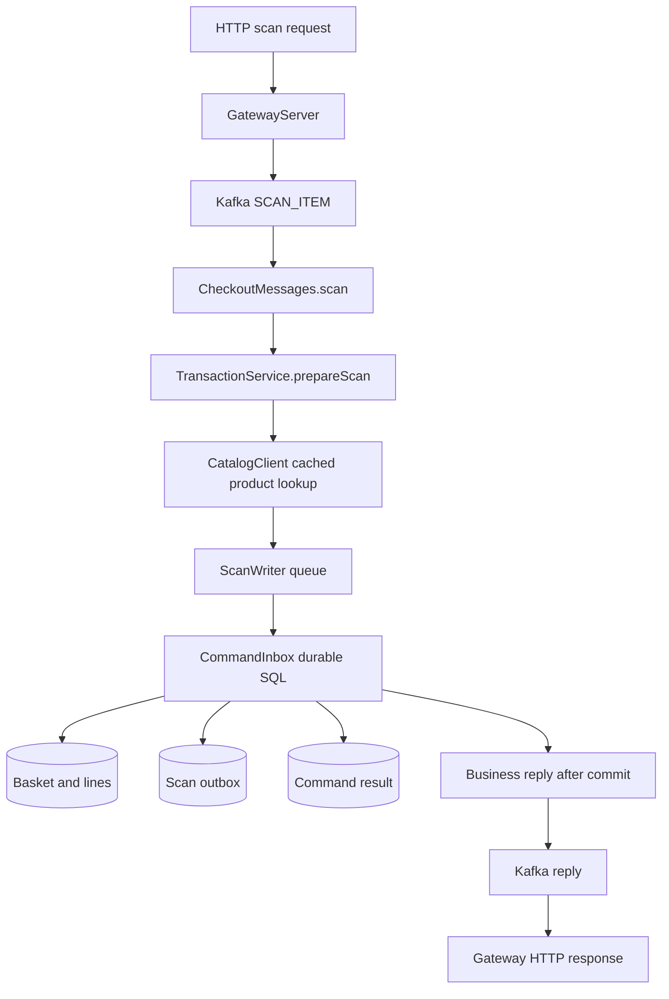
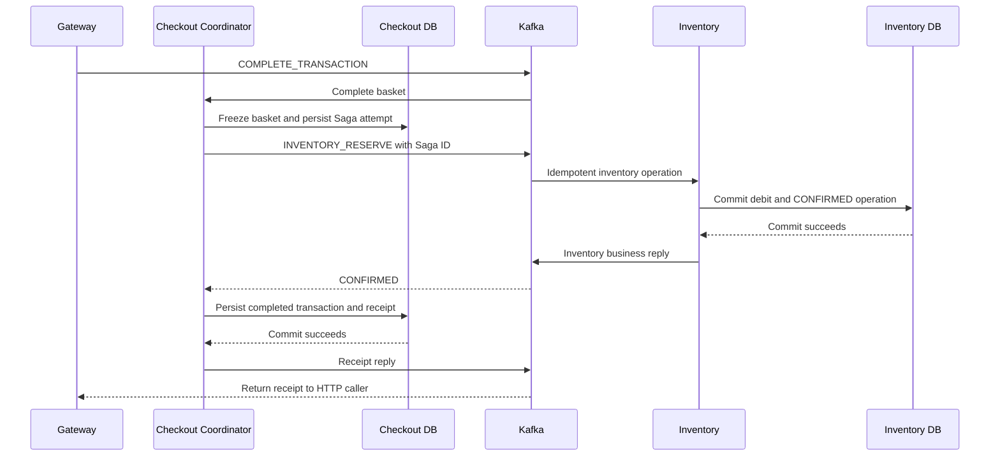
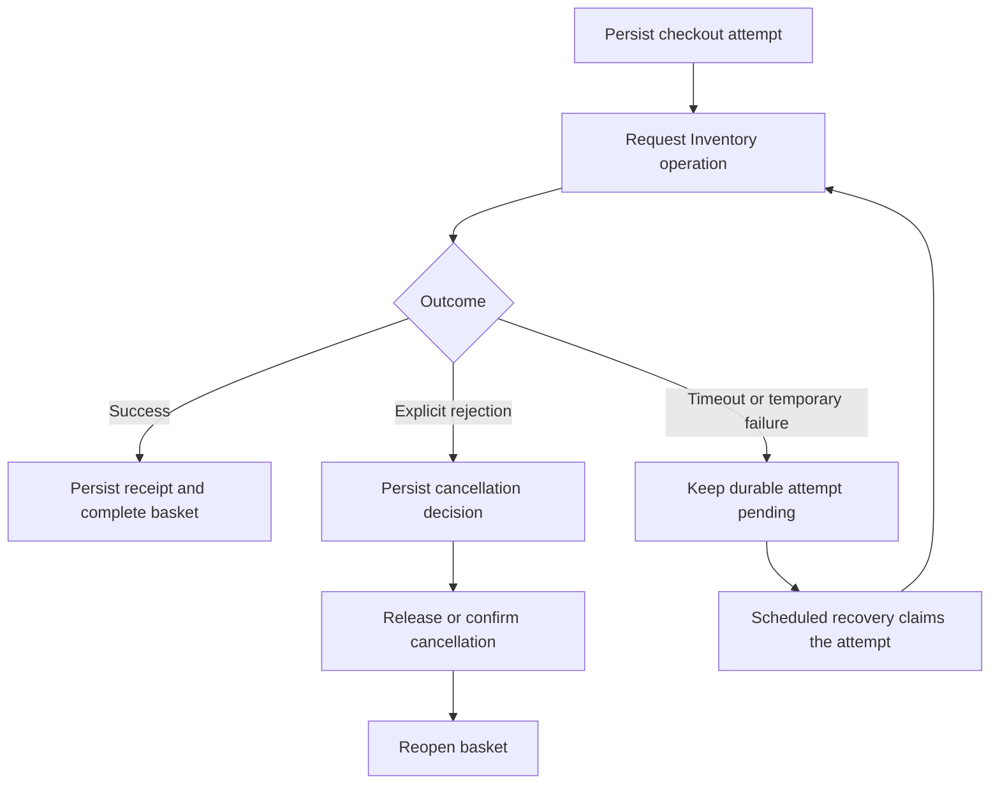
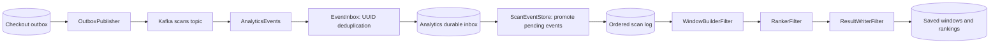

# Self Checkout: English Code Walkthrough

This guide follows a customer's shopping session through the actual Java implementation in `event-driven-server`. It explains module ownership, class relationships, message delivery, database commits, and recovery. Source links are relative to this document and work on GitHub.

Code excerpts below are taken from the local source; explanatory inline comments and blank lines are omitted where necessary. Some excerpts show only the relevant statements, not a complete compilable class. Business flow diagrams describe the implementation's intended paths; they are not evidence of a new test run.

## 1. The business model and deployment boundaries

A station starts a transaction, scans items, and completes checkout. Catalog supplies names and prices. Checkout owns the basket and receipt. Inventory debits stock at completion, not at scan time. Analytics counts scanned items, including scans in baskets that have not completed; its ranking is not a completed-sales revenue report.



There are five application processes and four private databases. Kafka is a separate infrastructure process. `event-messaging` is a shared library loaded into the application processes, not a sixth microservice. No service reads another service's database.

| Maven module | Responsibility | Entry point |
| --- | --- | --- |
| `gateway` | Public HTTP routes and Kafka request/reply | [GatewayMain.java](../gateway/src/main/java/edu/cs6510/servicebased/gateway/GatewayMain.java) |
| `catalog-service` | Fixed product catalog | [CatalogApplication.java](../catalog-service/src/main/java/edu/cs6510/servicebased/catalog/CatalogApplication.java) |
| `checkout-service` | Baskets, receipts, durable checkout coordination and scan outbox | [CheckoutApplication.java](../checkout-service/src/main/java/edu/cs6510/servicebased/checkout/CheckoutApplication.java) |
| `inventory-service` | Stock, idempotent debits and low-stock queries | [InventoryApplication.java](../inventory-service/src/main/java/edu/cs6510/servicebased/inventory/InventoryApplication.java) |
| `analytics-service` | Durable scan ingestion, windows and rankings | [AnalyticsApplication.java](../analytics-service/src/main/java/edu/cs6510/servicebased/analytics/AnalyticsApplication.java) |
| `event-messaging` | Shared transport interface and native Kafka adapter | [MessageBus.java](../event-messaging/src/main/java/edu/cs6510/events/MessageBus.java) and [KafkaBus.java](../event-messaging/src/main/java/edu/cs6510/events/KafkaBus.java) |

The parent [pom.xml](../pom.xml) aggregates the modules and centralizes build settings. Each module has its own `pom.xml`. Business services use Spring Boot; Gateway has its own Java entry point and HTTP implementation. The project uses native Kafka Java clients rather than Spring Kafka.

## 2. How Java folders relate

```text
<module>/
  src/main/java/edu/cs6510/...
    *Application.java       Service startup
    *Events / *Messages     Kafka entry adapters
    *Service                Business operations
    *Client                 Outbound adapters to other services
    contract/               Request and response records
    persistence/            Local database access
      entity/               Database entities, where used
    common/                 Local exceptions and HTTP error/health helpers
  src/main/resources/       Runtime configuration
  src/test/java/            Tests, not production request handlers
  database/                 Database schema and migration SQL
```

Not every module has every folder. Inventory defines several DTO records inside `InventoryService`; Checkout uses JDBC stores rather than an entity for every table. The `servicebased` package name is inherited from the previous version and does not determine the current transport.

A Java method call such as `checkout.prepareScan(...)` stays inside one JVM. A call such as `bus.request("inventory", ...)` crosses a process boundary through Kafka. The assignment's prohibition on direct service calls does not prohibit ordinary method calls inside a service.

Spring constructor injection connects local objects. For example, `CatalogClient(MessageBus bus)` receives the bus created by `MessagingConfiguration`; it does not launch Kafka. Spring's `ApplicationReadyEvent` hooks register consumers, and scheduled tasks drive outbox publication and recovery.

## 3. The messaging boundary

Start with [MessageBus.java](../event-messaging/src/main/java/edu/cs6510/events/MessageBus.java). Its four central operations are:

```java
Reply request(String service, String operation, String key, String body);
void publish(String topic, String key, String body);
void serve(String service, Function<Request, Reply> handler);
void subscribe(String topic, String group, Consumer<List<String>> handler);
```

| Operation | Meaning | Example |
| --- | --- | --- |
| `request` | Send and wait for the consumer's business reply | Checkout requests an Inventory debit |
| `publish` | Send and wait for Kafka's acknowledgment | Checkout publishes scan batches |
| `serve` | Register a request handler | Checkout registers its operation dispatcher |
| `subscribe` | Consume event batches | Analytics receives scans |

`publish` returning does **not** mean Analytics has processed the event. `request` returning a successful business reply means the handler has completed the relevant business operation. A timeout can leave the business outcome unknown; it is not proof that the consumer did nothing.

| File | Relationship to the rest of the library |
| --- | --- |
| [MessagingConfiguration.java](../event-messaging/src/main/java/edu/cs6510/events/MessagingConfiguration.java) | Creates the Spring-managed `MessageBus` |
| [KafkaBus.java](../event-messaging/src/main/java/edu/cs6510/events/KafkaBus.java) | Implements producers, consumers, correlation, timeouts and offset handling |
| [Request.java](../event-messaging/src/main/java/edu/cs6510/events/Request.java) / [Reply.java](../event-messaging/src/main/java/edu/cs6510/events/Reply.java) | Transport request and business outcome records |
| [KafkaEnvelope.java](../event-messaging/src/main/java/edu/cs6510/events/KafkaEnvelope.java) | Encodes business JSON and metadata into Kafka records |
| [Json.java](../event-messaging/src/main/java/edu/cs6510/events/Json.java) | Serializes and deserializes DTOs |
| [Responses.java](../event-messaging/src/main/java/edu/cs6510/events/Responses.java) | Validates input and converts outcomes/exceptions into replies |
| [BusException.java](../event-messaging/src/main/java/edu/cs6510/events/BusException.java) | Signals transport failures |
| [KeyedDispatcher.java](../event-messaging/src/main/java/edu/cs6510/events/KeyedDispatcher.java) | Serializes local work for the same key while allowing unrelated keys to progress |
| [PartitionProgress.java](../event-messaging/src/main/java/edu/cs6510/events/PartitionProgress.java) | Tracks completed work so offsets do not pass unfinished records |

`KafkaBus.request()` generates a correlation UUID and associates it with a `CompletableFuture<Reply>`. Its reply consumer resolves that future using the response ID. The caller waits on the future; the command consumer is not the thread responsible for receiving that caller's replies.

Correlation IDs and business keys have different purposes: the request ID identifies one message exchange; a transaction ID or Saga ID identifies the business work. A fresh HTTP retry can create a fresh correlation ID.

The current envelope keeps business JSON in the record value and metadata in versioned Kafka headers. Legacy JSON envelopes remain readable, and replies match the incoming encoding. This is a transport optimization, not a public API change.

## 4. Gateway translates HTTP into Kafka operations

[GatewayServer.java](../gateway/src/main/java/edu/cs6510/servicebased/gateway/GatewayServer.java) matches the route, chooses a destination and operation, and relays the resulting status and JSON to the HTTP caller. [GatewayConfig.java](../gateway/src/main/java/edu/cs6510/servicebased/gateway/GatewayConfig.java) reads settings; [Http.java](../gateway/src/main/java/edu/cs6510/servicebased/gateway/Http.java) handles HTTP framing and response helpers.

The scan route contains:


```java
return relay(bus.request("checkout", "SCAN_ITEM", transactionId, body));
```


The public API therefore remains synchronous even though its internal transport is event-based.

| Public operation | Destination / Kafka operation |
| --- | --- |
| `GET /items` | Catalog / `GET_CATALOG` |
| `POST /transactions` | Checkout / `START_TRANSACTION` |
| `GET /transactions/{id}` | Checkout / `GET_TRANSACTION` |
| `POST /transactions/{id}/items` | Checkout / `SCAN_ITEM` |
| `POST /transactions/{id}/complete` | Checkout / `COMPLETE_TRANSACTION` |
| `GET /inventory/low-stock` | Inventory / `GET_LOW_STOCK` |
| `GET /analytics/popular-items` | Checkout / `SCAN_CHECKPOINT`, then Analytics / `GET_POPULAR_ITEMS` |

## 5. Starting a basket and resolving products



[CheckoutMessages.java](../checkout-service/src/main/java/edu/cs6510/servicebased/checkout/CheckoutMessages.java) dispatches messages by operation. START validates through `TransactionService.prepareStation()` and delegates to `CommandInbox.start()`. The latter stores the basket and replayable response together. A redelivery with the same command ID returns the recorded response instead of creating a second basket.

Catalog follows this local dependency chain:

```text
CatalogEvents → CatalogService → CatalogCache → CatalogItemRepository → Catalog DB
```

[CatalogEvents.java](../catalog-service/src/main/java/edu/cs6510/servicebased/catalog/CatalogEvents.java) handles Kafka requests. [CatalogCache.java](../catalog-service/src/main/java/edu/cs6510/servicebased/catalog/persistence/CatalogCache.java) loads the service's immutable catalog snapshot; [CatalogItemRepository.java](../catalog-service/src/main/java/edu/cs6510/servicebased/catalog/persistence/CatalogItemRepository.java) accesses the table represented by [CatalogItem.java](../catalog-service/src/main/java/edu/cs6510/servicebased/catalog/persistence/entity/CatalogItem.java). `CatalogResponse` and `CatalogItemResponse` are data records, not database clients.

Checkout's separate [CatalogClient.java](../checkout-service/src/main/java/edu/cs6510/servicebased/checkout/CatalogClient.java) obtains that catalog through Kafka and caches it locally. Most scans therefore do not require a Catalog round trip. The assignment assumes a fixed catalog; this is not a live cache-invalidation system.

## 6. Scanning: durable basket changes and replay safety



The Kafka scan path differs from the retained HTTP controller path: it prepares the product through `TransactionService`, then uses `ScanWriter` and `CommandInbox` for durable deduplication and batching. Do not assume every scan goes through `TransactionService.scanItem()`.

The dispatch table includes these branches:


```java
case "GET_TRANSACTION" -> Responses.call(()->checkout.getTransaction(request.key()));
   case "SCAN_ITEM" -> scan(request);
   case "COMPLETE_TRANSACTION" -> Responses.call(()->checkout.completeTransaction(request.key()));
```


[ScanWriter.java](../checkout-service/src/main/java/edu/cs6510/servicebased/checkout/ScanWriter.java) has a bounded queue and coalesces scans already waiting, without intentionally delaying requests to fill a batch. The default batch limit is 64 independent baskets/command IDs. [CommandInbox.java](../checkout-service/src/main/java/edu/cs6510/servicebased/checkout/persistence/CommandInbox.java) atomically stores basket totals, lines, scan outbox entries and command results. A successful caller waits for its durable result. Batch failures can fall back to individual execution using the original IDs.

[CheckoutStore.java](../checkout-service/src/main/java/edu/cs6510/servicebased/checkout/persistence/CheckoutStore.java) provides ordinary basket, scan and receipt database operations used by other local paths. `contract/` defines `StartTransactionRequest`, `ScanItemRequest`, `TransactionResponse`, `ScanResult`, `Receipt` and `ReceiptLine`. These records carry data; they do not send messages.

A replayed Kafka command ID is deduplicated. This does not provide universal deduplication of new HTTP requests: a newly submitted scan with a new ID can legitimately represent another item.

## 7. Completion: a durable, orchestrated Saga

[TransactionService.java](../checkout-service/src/main/java/edu/cs6510/servicebased/checkout/TransactionService.java) delegates completion to [CheckoutCoordinator.java](../checkout-service/src/main/java/edu/cs6510/servicebased/checkout/CheckoutCoordinator.java). [SagaStore.java](../checkout-service/src/main/java/edu/cs6510/servicebased/checkout/persistence/SagaStore.java) freezes the basket, persists the attempt and its state, and coordinates ownership through a lease. [InventoryClient.java](../checkout-service/src/main/java/edu/cs6510/servicebased/checkout/InventoryClient.java) sends inventory commands keyed by the persisted Saga ID.



The key coordinator statements are:


```java
try { reserved=inventory.reserve(work.id(),work.lines()); }
   catch(InventoryClient.Rejected ex) { work=store.decide(work,"CANCELLING"); }
   if(reserved!=null) {
    if(reserved.equals("RESERVED")) inventory.confirm(work.id());
    return store.finish(work);
   }
```


The normal current Inventory path debits stock and stores a `CONFIRMED` record atomically, although the command retains the name `INVENTORY_RESERVE`. The coordinator also accepts older `RESERVED` outcomes and retains confirm/release recovery branches. Do not describe every checkout as requiring two remote inventory phases.

[InventoryEvents.java](../inventory-service/src/main/java/edu/cs6510/servicebased/inventory/InventoryEvents.java) dispatches requests to [InventoryService.java](../inventory-service/src/main/java/edu/cs6510/servicebased/inventory/InventoryService.java). [DebitWriter.java](../inventory-service/src/main/java/edu/cs6510/servicebased/inventory/DebitWriter.java) coalesces debits to reduce contention and durable commit overhead. Unique operation IDs prevent repeated debits; existing IDs are checked for compatible results. Inventory's request/response records are mostly nested inside `InventoryService`.



A timeout preserves uncertainty; it must not be interpreted as a stock rejection. If Inventory commits but Checkout crashes before saving the receipt, recovery retries the same Saga ID. Inventory does not debit a second time, and Checkout can finish locally. Duplicate completion of an already completed transaction returns its existing receipt.

`SchedulingConfig` separates outbox work from checkout recovery so Analytics delivery delays do not monopolize the recovery scheduler. A successful completion HTTP response means Inventory and Checkout have persisted their respective results; there is no cross-service database transaction.

## 8. Outbox to Analytics: asynchronous event delivery

Scanning and analytics run on separate paths. Checkout writes a scan outbox row in the same database operation as the basket update. [OutboxPublisher.java](../checkout-service/src/main/java/edu/cs6510/servicebased/checkout/OutboxPublisher.java) later performs these statements in order:


```java
var events=store.pending();
  if(events.isEmpty()) return 0;
  client.deliver(events);
  store.acknowledge(events);
  return events.size();
```


[AnalyticsClient.java](../checkout-service/src/main/java/edu/cs6510/servicebased/checkout/AnalyticsClient.java) implements delivery with:


```java
bus.publish(bus.topic("scans"),"checkout-scans",Json.write(new Batch(events)));
```


If publication fails, outbox rows remain pending. If the process crashes after Kafka accepts an event but before the outbox is marked, the event can be sent again with the same event UUID.



[AnalyticsEvents.java](../analytics-service/src/main/java/edu/cs6510/servicebased/analytics/AnalyticsEvents.java) registers both an event subscriber and a query handler:


```java
bus.subscribe(bus.topic("scans"), "analytics-scans", this::accept);
        bus.serve("analytics", this::handle);
```


[EventInbox.java](../analytics-service/src/main/java/edu/cs6510/servicebased/analytics/EventInbox.java) deduplicates event IDs transactionally. The subscriber callback returns after durable inbox acceptance; the Kafka offset can then advance. It does **not** wait for every ranking window to be computed. [ScanEventStore.java](../analytics-service/src/main/java/edu/cs6510/servicebased/analytics/persistence/ScanEventStore.java) promotes pending inbox records into the local ordered scan log, including tail records that do not yet form a ranking boundary.

## 9. Analytics is a local three-stage pipeline

[AnalyticsPipeline.java](../analytics-service/src/main/java/edu/cs6510/servicebased/analytics/AnalyticsPipeline.java) connects three stages using bounded Java queues inside one process. These queues are not additional Kafka topics.

| Stage | Input → output | Responsibility |
| --- | --- | --- |
| [WindowBuilderFilter.java](../analytics-service/src/main/java/edu/cs6510/servicebased/analytics/WindowBuilderFilter.java) | Scan log → `WindowBatch` | Read a precise scan range |
| [RankerFilter.java](../analytics-service/src/main/java/edu/cs6510/servicebased/analytics/RankerFilter.java) | `WindowBatch` → `RankedWindow` | Count SKUs and rank deterministically |
| [ResultWriterFilter.java](../analytics-service/src/main/java/edu/cs6510/servicebased/analytics/ResultWriterFilter.java) | `RankedWindow` → database | Persist the result through `AnalyticsWindowStore` |

[PipelineData.java](../analytics-service/src/main/java/edu/cs6510/servicebased/analytics/PipelineData.java) defines a maximum window size of 1,000 scans, a slide of 500, and a top limit of 10. The first result covers scans 1–500; the next covers 1–1,000; the next covers 501–1,500. These are count-based windows, not time-based windows.

The ranking logic groups the scanned SKUs:


```java
var counts = batch.skus().stream()
                .collect(Collectors.groupingBy(sku -> sku, Collectors.counting()));
```


Ties are broken by SKU, making results deterministic. [AnalyticsWindowStore.java](../analytics-service/src/main/java/edu/cs6510/servicebased/analytics/AnalyticsWindowStore.java) saves rankings and the committed sequence checkpoint using the window/ranking repositories and entities. After restart, the pipeline resumes from the last published checkpoint; its transient queue contents need not survive.

[AnalyticsService.java](../analytics-service/src/main/java/edu/cs6510/servicebased/analytics/AnalyticsService.java) reads the latest saved ranking. `PopularItem` and `PopularItemsResponse` define the public result, while `AnalyticsWindow` and `PopularItemResult` represent stored data.

## 10. Reading a sufficiently current ranking

The Gateway first requests `SCAN_CHECKPOINT` from Checkout. It sends that durable scan count to Analytics as `minimumScans` in `GET_POPULAR_ITEMS`. Analytics waits, within a bounded timeout, for ingestion and the due ranking windows before reading the result.

This is a catch-up requirement rather than an atomic snapshot across services. Concurrent new scans may arrive while the query runs. Fewer than 500 scans do not create a new ranking window; the query waits only for windows that are due. If catch-up takes too long, the service returns a temporary failure rather than presenting that request as successfully caught up.

## 11. Delivery guarantees and error boundaries

| Mechanism | What it protects | Limit |
| --- | --- | --- |
| Checkout command results | Duplicate START/SCAN message IDs | New HTTP requests can have new IDs |
| Inventory Saga IDs | Repeated stock commands during recovery | An ID must identify the same business operation |
| Checkout outbox | Scan event recorded with basket update | Publication can repeat |
| Analytics inbox | Repeated event UUIDs | Ranking still advances asynchronously |
| Partition completion tracking | Offsets do not skip unfinished work | Crashes can cause redelivery |
| Kafka producer idempotence | Certain producer retry duplicates | Not end-to-end exactly-once business execution |

The system uses at-least-once delivery with application-level idempotency. There is no distributed PostgreSQL/Kafka transaction. Normal local keyed dispatch preserves same-key handler sequencing, but it is not a claim of global total order across failures and replicas.

Retained `*Controller` classes support HTTP diagnostics and compatibility tests. Production inter-service business traffic uses Kafka. `GlobalExceptionHandler` handles HTTP exceptions; message handlers use `Responses` to produce Kafka replies. Health probes are operational checks, not service-to-service business calls.

The demonstrated Kafka deployment has one broker and replication factor 1. It does not demonstrate broker high availability or production-scale capacity.

## 12. What changed from microservices-server?

| Concern | Previous microservices version | Event-driven version |
| --- | --- | --- |
| Service boundaries | Gateway and four business services | Preserved |
| External client API | Synchronous HTTP | Preserved |
| Internal business transport | Direct HTTP | Kafka request/reply and scan events |
| Catalog cache | Immutable cached catalog | Preserved, populated through Kafka |
| Inventory coordination | Durable Saga with HTTP adapter | Durable Saga with Kafka adapter |
| Scan publication | Outbox delivery to Analytics HTTP endpoint | Outbox publication acknowledged by Kafka; Analytics consumes independently |
| Redelivery handling | Existing operation/event idempotency | Adds durable Kafka START/SCAN command results and transport offset tracking |
| Final ranking query | HTTP-based service interactions | Kafka checkpoint and bounded Analytics catch-up |

The original version already had a Saga, an outbox and catalog caching. The architectural change is their integration with Kafka and its acknowledgment, correlation and replay semantics.

## 13. Suggested VS Code reading and demonstration order

1. Open `GatewayServer` and locate `SCAN_ITEM`: explain how the external route becomes a message.
2. Open `MessageBus`, then `KafkaBus.request`: distinguish an interface from its Kafka implementation and identify the correlation future.
3. Open `CheckoutMessages`: show registration and operation dispatch.
4. Follow `prepareScan` into `CatalogClient`, then follow `ScanWriter` into `CommandInbox`: identify the durable boundary.
5. Follow completion into `CheckoutCoordinator`, `SagaStore`, `InventoryClient`, `InventoryEvents` and `DebitWriter`.
6. Follow `OutboxPublisher` into `AnalyticsClient`, then `AnalyticsEvents` and `EventInbox`.
7. Open `AnalyticsPipeline` and its three filters; explain the 500-scan slide and restart checkpoint.
8. Return to the Gateway popular-items route and explain why catch-up is necessary.

For a live walkthrough, start Kafka, start the five application services using the setup in [README](../README.md), then call the public API. For measured reports, use the isolated runner instead of starting a second set of services manually. [PERFORMANCE](../PERFORMANCE.md) documents the accepted workload configuration; [SUBMISSION](../SUBMISSION.md) links the required reports and diagram.

Tests under each module's `src/test/java` validate that module's contracts and failure behavior. Examples include command replay/atomicity tests, coordinator recovery tests, batch-writer tests, offset-prefix tests, and Analytics pipeline tests. Existing verification evidence is in [validation.json](../reports/submission/validation.json); it should not be mistaken for a fresh test run of subsequent local edits.
