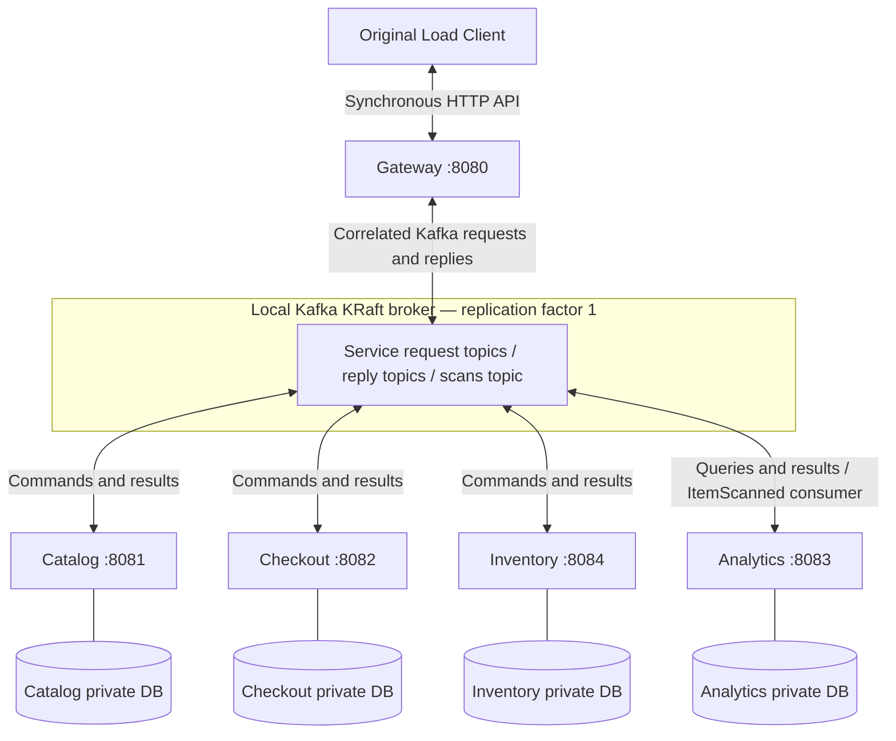
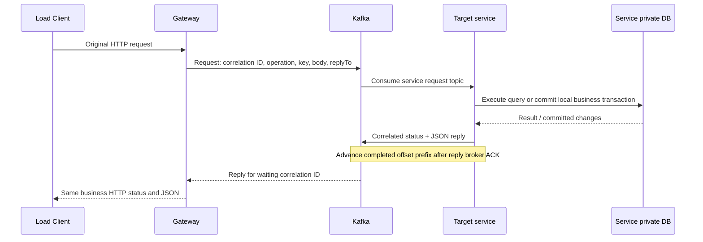

# Architecture and message flows

The service boundaries are unchanged from the Microservices assignment. Gateway, Catalog, Checkout, Inventory and Analytics are five separate Java processes. The `event-messaging` Maven module is a shared library used inside those processes, not another service. Its `MessageBus` interface is implemented by `KafkaBus` using native Apache Kafka producers, consumers and the Admin API.

[Standalone architecture diagram](architecture.svg)

## Deployment topology



The HTTP arrows above represent the external business API only. The startup manager also probes each process's local `/health` endpoint. Existing service HTTP controllers remain available for diagnostics and compatibility tests, but no running service calls another service over HTTP. Gateway rejects internal and unknown routes. Every service uses its own PostgreSQL connection configuration; there are no shared repositories, cross-database joins or cross-service foreign keys.

## Topics and contracts

The default topic prefix is `selfcheckout`; tests and benchmarks use separate namespaces. Topics are created by `KafkaBus` at startup.

| Topic suffix | Producer → consumer | Purpose / default partitions |
| --- | --- | --- |
| `catalog.requests` | Gateway or Checkout → Catalog | `GET_CATALOG` / 4 |
| `checkout.requests` | Gateway → Checkout | `START_TRANSACTION`, `GET_TRANSACTION`, `SCAN_ITEM`, `COMPLETE_TRANSACTION`, `SCAN_CHECKPOINT` / 4 |
| `inventory.requests` | Gateway or Checkout → Inventory | `GET_LOW_STOCK`, `INVENTORY_RESERVE`, `INVENTORY_GET`, `INVENTORY_CONFIRM`, `INVENTORY_RELEASE` / 4 |
| `analytics.requests` | Gateway → Analytics | `GET_POPULAR_ITEMS` / 4 |
| `<service>.replies` | Handling service → original requester | One reply topic for each of the five service names / 1 |
| `scans` | Checkout outbox → Analytics | Batches representing `ItemScanned` domain events / 1 |

A full topic name is `<prefix>.<suffix>`. A request is `{id, operation, key, body, replyTo}`. The reply envelope contains the request `id` and a `{status, body}` result; bodies are JSON strings serialized by the shared `Json` helper. Requests use transaction ID or Saga ID as their partition key where relevant; unrelated queries and transaction starts use distinct keys. The outbox publishes scan batches with a common scan-stream key.

Command/query RPC messages express requested work. `ItemScanned` describes a committed business fact. This architecture uses both forms; it does not call every broker record a domain event.

Reply consumers are separate from command pollers, allowing Checkout to await an Inventory reply without blocking its reply subscription. Command pollers share a group per service; each business service defaults to one poller. Each poller dispatches up to 64 records per poll to virtual-thread business handlers. Network poller counts do not cap the number of unrelated business keys that can execute concurrently.

Command/reply and scan-event fetch waits both default to 500 ms with `fetch.min.bytes=1`. The wait applies when no sufficient data is available; an available record satisfies the minimum immediately. This avoids frequent empty fetches and their allocation overhead observed in JFR. The command poll timeout is independently configurable through `KAFKA_COMMAND_POLL_MS` (default 100 ms). `KAFKA_PERFORMANCE_LOG` enables cumulative stage timings for diagnosis and defaults to false, keeping diagnostic sampling off during normal runs.

`KeyedDispatcher` serializes work for the same business key within a process while unrelated keys proceed independently. A command is complete only after its handler and correlated reply publication have succeeded, including the producer's `acks=all` acknowledgment. `PartitionProgress` tracks out-of-order completions and permits committing only the completed prefix of delivered records in each partition. Offset commits are asynchronous, at most once per 100 ms of poll-loop progress; shutdown and revocation commit only the known completed prefix. Failed work pauses the partition until dispatched work has finished, then seeks to the earliest failed offset for replay. Assignment tokens prevent late results from an old assignment from advancing a new owner's offsets.

Normal same-key processing is serialized, but a failed command may be replayed after other work has run; old workers can also finish after reassignment. These rules provide at-least-once processing with local idempotency, not strict command ordering throughout faults or a total order across replicas/topics. Per-instance reply consumers correlate pending futures and need no durable offsets.

## Synchronous request/response



Gateway returns no early `202 Accepted`. Service errors retain their status/body. A transport failure gives 502; a request timeout gives 504. A timeout is an unknown business outcome and is not evidence that the operation was rolled back. Requesters wait for the correlated business reply without first blocking on a separate producer-send acknowledgment; send failures still fail the waiting future.

Checkout's START path uses one autocommitted PostgreSQL statement to write the basket and replayable command result. SCAN defaults to a `ScanWriter` that drains already queued requests into batches of at most 64 distinct baskets and request IDs. Its bounded queue holds 512 requests, and it adds no intentional collection delay. Duplicate IDs or baskets are deferred to later batches in local queue order. A one-request batch uses the original single-scan SQL; disabling `CHECKOUT_SCAN_BATCHING_ENABLED` also selects that path.

Each batch uses one atomic SQL statement to lock baskets in stable transaction-ID order and commit their line changes, totals, outbox events and command results together. Cached results bypass writes. Missing and closed baskets receive independent 404/409 results while valid baskets commit. If a constraint or concurrent duplicate aborts the statement, the writer retries each command through the single-scan path with its original ID. The request-ID unique constraint rolls back a losing duplicate's entire statement; a fresh read returns the winner's saved result. A successful reply is released only after the database call has committed. Batch size/write-time diagnostics are opt-in through `CHECKOUT_SCAN_PERFORMANCE_LOG` (default false). See [ADR 0004](adr/0004-durable-batched-scans.md).

Queue-full and stopping conditions return explicit 503 results. An accepted scan that exceeds the six-second wait can still commit; its timeout is an unknown outcome, not a rollback. The public HTTP contract does not accept the internal Kafka request ID, so issuing another HTTP scan is not automatically an idempotent retry of the first one.

## Scan event propagation

```mermaid
sequenceDiagram
    participant G as Gateway
    participant K as Kafka
    participant C as Checkout
    participant CD as Checkout DB
    participant P as Outbox publisher
    participant A as Analytics
    participant AD as Analytics DB
    G->>K: SCAN_ITEM(transaction ID, SKU)
    K->>C: Consume scan command
    Note over C,CD: ScanWriter drains already queued independent baskets (max 64)
    C->>CD: One atomic SQL: basket changes + outbox + command results
    CD-->>C: Committed
    C->>K: Successful scan reply
    K-->>G: Reply; HTTP scan can finish
    P->>CD: Read pending outbox batch
    P->>K: Publish ItemScanned batch to scans
    K-->>P: Broker acknowledgement
    P->>CD: Mark batch published
    K->>A: Consume scan batches
    A->>AD: Commit deduplicated inbox + canonical events
    AD-->>A: Committed
    A->>K: Commit consumed offsets
    Note over A,AD: Ranking pipeline persists each due hopping window
```

A publisher crash after broker acknowledgement and before the outbox update can duplicate publication. A consumer crash after its database commit and before its offset commit can duplicate consumption. Stable event UUIDs and payload validation make both retries safe; the same ID with a different payload is rejected. Rankings are derived asynchronously from the canonical events.

For `GET /analytics/popular-items`, Gateway first obtains `SCAN_CHECKPOINT` from Checkout and sends that count as `minimumScans` with the Analytics query. Analytics waits for canonical ingestion and all ranking windows due at the checkpoint; it returns an explicit error if catch-up exceeds its configured budget. Scan acknowledgements themselves do not wait for Analytics.

## Orchestrated checkout Saga

```mermaid
sequenceDiagram
    participant G as Gateway
    participant K as Kafka
    participant C as Checkout coordinator
    participant CD as Checkout DB
    participant I as Inventory
    participant ID as Inventory DB
    G->>K: COMPLETE_TRANSACTION(transaction ID)
    K->>C: Consume completion command
    C->>CD: Freeze basket; persist Saga ID and recovery lease
    CD-->>C: RESERVING work
    C->>K: INVENTORY_RESERVE(key = persisted Saga ID)
    K->>I: Deliver idempotent inventory command
    I->>ID: Atomically check/debit whole basket; persist CONFIRMED result
    ID-->>I: Commit or reject without partial debit
    I->>K: Inventory result
    K-->>C: Correlated Inventory outcome
    alt Inventory confirmed
        C->>CD: Persist COMPLETED transaction, receipt and DONE Saga
        CD-->>C: Committed
        C->>K: Successful receipt reply
        K-->>G: HTTP completion may succeed
    else Inventory explicitly rejected
        C->>CD: Persist CANCELLING decision
        C->>K: INVENTORY_RELEASE using same Saga ID
        K->>I: Idempotent cancellation
        I->>ID: Persist cancellation outcome
        I->>K: Cancellation result
        K-->>C: Cancellation acknowledged
        C->>CD: Finish cancelled attempt; reopen basket
        C->>K: Conflict reply
        K-->>G: HTTP 409
    else Reply missing or transient failure
        C->>CD: Retain durable work for scheduled recovery
        Note over C,I: Retry same Saga ID; never assume a timed-out debit failed
        C->>K: Pending/error reply if a response is possible
    end
```

The normal `INVENTORY_RESERVE` success already persists the inventory debit as `CONFIRMED`. `INVENTORY_CONFIRM` remains for compatibility with persisted older two-step Saga work. Checkout then has only a retryable local completion step. Recovery reuses the durable attempt ID and supports `COMMITTING` / `CANCELLING` states. This is explicit orchestration, not pure choreography; each database commits independently.

## Delivery and deployment limits

The producer uses `acks=all` and producer idempotence. Command consumers commit completed prefixes after business processing and reply acknowledgments; scan consumers commit after durable inbox processing. Failures retain work for replay. Those settings do not make database writes atomic with Kafka offsets. The design relies on application idempotency, transactional outbox/inbox and recoverable Sagas for at-least-once handling.

The Compose broker is a single KRaft node with replication factor 1 and a persistent volume. The optional `scripts/kafka-local.py` foreground launcher runs the official Kafka 4.2.1 distribution natively at `127.0.0.1:19092` (controller: `19093`). Initial distribution extraction requires Docker and the cached official image; subsequent native runs use `target/kafka-dist` without a Docker VM. Data is retained at `target/native-kafka/data`, with configuration/logs under `target/native-kafka/19092`. Both deployments have replication factor 1 and no broker-failure redundancy or demonstrated zero-downtime migration. Benchmark evidence records the actual deployment.

The benchmark's optional `--database-locale=C` experiment sets collation and character classification only when creating its temporary logical databases. The normal default is inherited locale, and application startup does not change existing database collation. Locale changes must be identified separately in performance comparisons.

Poison records currently retry and can block their partition; no dead-letter workflow is claimed. Persisted command results/outbox/inbox need a future retention policy for long-lived production use. See [ADRs](adr/0001-use-kafka.md) for the scoped decisions.
