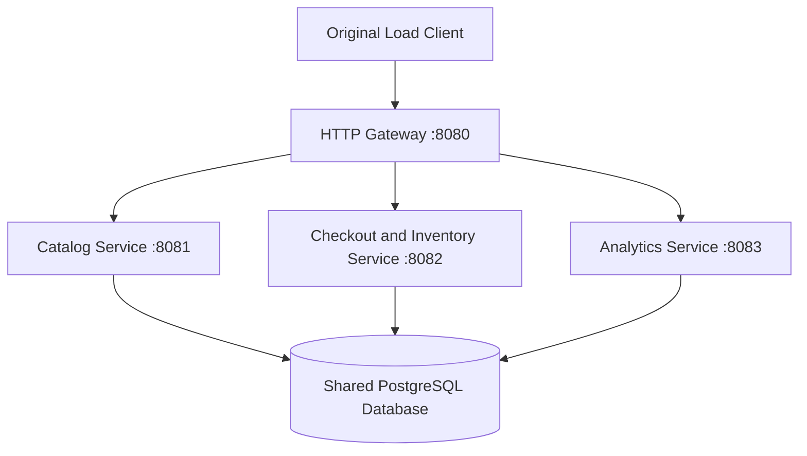

# Self Checkout — Service Based Architecture

This directory contains the CS6510 Service Based Architecture assignment. The system is decomposed into three independently deployable domain services that share one centralized PostgreSQL database. The original load client accesses the existing API through a separate HTTP gateway.

Repository: [Anne-Zeng/CS6510-2026](https://github.com/Anne-Zeng/CS6510-2026). See [SUBMISSION.md](SUBMISSION.md) for the service list and assignment submission notes, and [PERFORMANCE.md](PERFORMANCE.md) for the bilingual performance analysis. The previous monolith, layered, and pipeline implementations remain in their own directories.

## Domain services

| Domain service | Default port | Business responsibilities | API |
|---|---:|---|---|
| Catalog Service | 8081 | Read product SKUs, names, and prices | `GET /items` |
| Checkout and Inventory Service | 8082 | Create transactions, scan items, return receipts, complete checkout, deduct stock, and report low stock | `/transactions/**`, `GET /inventory/low-stock` |
| Analytics Service | 8083 | Process committed scan events, persist sliding-window Top 10 rankings, and serve the latest published ranking | `GET /analytics/popular-items` |

Each domain service has its own entry point, executable Spring Boot JAR, JVM, HTTP port, and database connection pool. Domain services communicate through the shared database; they do not call one another directly.

The **Gateway**, on port **8080**, is a separate JDK HTTP proxy that routes client requests and reuses backend connections. It is routing infrastructure rather than a fourth domain service. The **shared-persistence** module is a library containing API contracts, entities, repositories, caches, and database access code; it is not a running service.



Checkout and inventory belong to the same domain service because completing a purchase must update its transaction status and all inventory rows atomically. Insufficient stock rolls back the entire completion and leaves the basket `OPEN`. Transaction row locks prevent duplicate completion; ordered inventory locks, conditional updates, and database constraints protect stock consistency.

## Required reports and verified results

The following reports were generated locally on **October 16, 2026**, using the unchanged load-client source. Both workloads passed independent database audits and Analytics restart checks.

| Workload / original JSON | Stations | Requested duration | Completed transactions | Transactions/sec | Request errors | Completion P95 / P99 |
|---|---:|---:|---:|---:|---:|---|
| [Default](reports/submission/report-default.json) | 10 | 60 s | 13,392 | 222.79 | 0 | 14.32 / 31.09 ms |
| [Stress](reports/submission/report-stress.json) | 100 | 120 s | 27,691 | 230.14 | 0 | 134.69 / 227.55 ms |

Actual wall-clock durations were **60.111 s** and **120.321 s**, including completion of in-flight transactions. Default persisted **141,277 scans and 282 windows**; Stress persisted **289,996 scans and 579 windows**. Both outboxes were fully processed, with no source-event, SKU, inventory, or ranking mismatches.

Additional evidence:

- [Default database audit](reports/submission/correctness-default.json) and [Stress database audit](reports/submission/correctness-stress.json).
- [Runtime environment](reports/submission/environment.json), including JVM options and database pool limits.
- [19 passing Maven tests](reports/submission/unit-tests.json) and [10 passing PostgreSQL acceptance scenarios](reports/submission/integration-checks.json).

The archived Pipeline results were measured at a different time and with different JVM heap settings. The comparison in [PERFORMANCE.md](PERFORMANCE.md) describes these recorded runs; it does not establish that service-based architecture is generally faster.

## Prerequisites and configuration

The local scripts require:

- **JDK 21 or later**, with `java` and `javac` available. The compilation target is Java 21.
- A running **PostgreSQL 15 or later** instance and the `psql` command-line client.
- **Python 3** and **Bash**. The Python scripts use only the standard library.
- The included Maven Wrapper, `./mvnw` on macOS/Linux. The first build downloads Maven and project dependencies.

Run the following from the repository root, then use `service-based-server` as the working directory for the remaining commands:

```bash
# Purpose: enter the assignment directory.
cd service-based-server

# Purpose: confirm that the required tools are available.
java -version
javac -version
python3 --version
psql --version

# Purpose: configure the local shared database; adjust credentials for your machine.
export CHECKOUT_DB_HOST=localhost
export CHECKOUT_DB_PORT=5432
export CHECKOUT_DB_USER=postgres
export CHECKOUT_DB_PASSWORD=postgres
export CHECKOUT_DB_NAME=servicebaseddb
```

The database user needs permission to create a missing project database and initialize its schema. If a database is created in advance, the user must have the corresponding schema permissions. Scripts pass the password to `psql` through its environment rather than a command-line argument.

| Variable | Default | Purpose |
|---|---|---|
| `CHECKOUT_DB_HOST` | `localhost` | PostgreSQL host used by the scripts |
| `CHECKOUT_DB_PORT` | `5432` | PostgreSQL port |
| `CHECKOUT_DB_USER` | `postgres` | Database user |
| `CHECKOUT_DB_PASSWORD` | `postgres` | Database password |
| `CHECKOUT_DB_NAME` | `servicebaseddb` | Shared database for normal operation |
| `CHECKOUT_JAVA_OPTS` | `-Xms64m -Xmx256m` | JVM options for each Java service process launched by the scripts |
| `CHECKOUT_DB_POOL` | Catalog 8 / Checkout 16 / Analytics 8 | Optional override of a service's maximum database pool size |
| `JAVA_BIN` / `JAVAC_BIN` | `java` / `javac` | Java runtime and compiler used by the Python scripts |

When `CHECKOUT_DB_POOL` is exported for the managed cluster, it overrides all three services. The default pool limits total **32 connections**; the gateway does not connect to PostgreSQL. Each domain service loads a read-only product catalog snapshot, so this implementation assumes the catalog remains unchanged after initialization.

## Build and run

```bash
# Purpose: build the shared library, all deployable JARs, and run Maven tests.
./mvnw clean package

# Purpose: initialize the shared database and start the already-built services and gateway.
./run.sh --skip-build
```

Alternatively, `./run.sh` builds the project as part of startup. The script starts the three business services, waits for their `/health` checks, and then starts the gateway. After `All services ready` appears, use another terminal:

```bash
# Purpose: check the gateway and query the existing API through one entry point.
curl http://localhost:8080/health
curl http://localhost:8080/items
curl http://localhost:8080/inventory/low-stock
curl http://localhost:8080/analytics/popular-items
```

The gateway health endpoint checks the gateway process. Each business service's health endpoint also checks its database connection. Runtime logs are written to `target/runtime/`. Press **Ctrl+C** in the startup terminal to stop the four managed processes.

Normal startup preserves existing inventory, transactions, scan events, and rankings. It seeds an empty catalog and inventory once; it does not automatically replenish stock or erase history. If the default ports are occupied, use `./run.sh --skip-build --base-port=18090`; the gateway, catalog, checkout, and analytics ports become 18090–18093.

Run **one Analytics writer process per database**. The current pipeline coordinates its window computation within one Analytics instance.

## Correctness acceptance tests

```bash
# Purpose: verify real HTTP routing, transaction rollback, concurrency, and Analytics recovery.
python3 scripts/test-system.py

# Purpose: use another group of four ports when the defaults are occupied.
python3 scripts/test-system.py --base-port=18210
```

Choose one of these commands. The default suite uses **`servicebased_acceptance_checks`** and ports **18110–18113**. It resets that dedicated database's `public` schema and seeds 20 products with 1,000 units per SKU to make inventory races reproducible. It does not reset the normal `servicebaseddb` database.

The ten scenarios cover routing and business error statuses, invalid scans, outbox write rollback, inventory and completion rollback, duplicate completion, competition for the last unit, concurrent scans with exact totals, scan-versus-completion races, baskets scanned in opposite SKU orders, and Analytics recovery while Checkout remains available. Fault injection verifies that a silently cancelled completion also restores stock, and that a failed analysis promotion leaves source events available for retry. Test triggers are removed after their scenarios.

Results and process logs are saved in `target/integration/`; inspect `correctness.json` for `passed` and `failures`. The published evidence above records the successful 19-test Maven suite and ten database scenarios.

## Reproduce the required load tests

```bash
# Purpose: build, then run both required workloads with fresh benchmark data for each.
./scripts/run-benchmarks.sh

# Purpose: reuse the latest JARs and select the benchmark's four consecutive ports.
./scripts/run-benchmarks.sh --skip-build --base-port=18090
```

Choose one command. Both compile the original `../load-client/src/` sources into `target/load-client` without changing the client's business logic. Default leaves the client's workload parameters unchanged. Stress supplies exactly `--stations=100 --duration=120`. Both use the client's default basket size of **1–20 items**.

Each workload starts from the same fixtures in **`servicebased_acceptance`**: **2,000 products and 1,000,000 units per SKU**. Schema resets are restricted to dedicated database names beginning with `servicebased_acceptance`. On macOS, the wrapper temporarily prevents idle sleep with `caffeinate -i`; the assertion ends with the test process. Other platforms execute the tests directly.

After each load run, the script:

1. Checks client errors and the final low-stock response.
2. Waits for all accepted outbox events to reach the contiguous analysis log and for every due window to be persisted.
3. Restarts Analytics and checks that the persisted ranking is unchanged.
4. Stops the services and independently audits transaction counts, basket quantities and prices, stock conservation, event counts and source links, and every published ranking window.

Only after **both workloads and both audits pass** does the script update `reports/submission/`. Original client measurement values are copied without modification. Failed runs cannot replace the published reports.

Timestamped `reports/run-YYYYMMDD-HHMMSS/` directories retain client output, service logs, rankings before and after restart, and audit results locally. Git includes the selected submission evidence and archived comparison JSON in `reports/comparison/`; generated run directories, logs, and build outputs are ignored.

## Database schema and transaction design

The shared tables and constraints are defined explicitly in [database/schema.sql](database/schema.sql). [scripts/system.py](scripts/system.py) applies this file before starting the business services. Each service uses `spring.jpa.hibernate.ddl-auto=validate` to check the structure rather than creating it independently. There are no competing runtime seeders.

The previous Pipeline server uses a different setup: its `ddl-auto=update` setting lets Hibernate derive tables from annotated Java entities. A separate `.sql` file is therefore not required there. Both implementations store data in PostgreSQL; the difference is how their table structures are initialized.

[`TransactionService`](checkout-service/src/main/java/edu/cs6510/servicebased/checkout/TransactionService.java) coordinates explicit Spring-managed transactions. The shared JDBC [`CheckoutStore`](shared-persistence/src/main/java/edu/cs6510/servicebased/shared/persistence/CheckoutStore.java) reduces round trips on the frequent write paths:

- **Create:** directly insert a UUID transaction rather than performing a JPA merge existence check.
- **Scan:** one SQL request locks the transaction, upserts its basket line, updates totals, and inserts a durable `scan_outbox` event. Failure to record the event rolls back the basket change.
- **Complete:** first lock the transaction and read its stable basket. Then `completeWithInventory()` uses one CTE request to lock inventory in SKU order, conditionally deduct stock, and update the transaction status. The service checks both the debit count and the completion count; any mismatch rolls back the whole transaction.

Successful write responses require a committed database transaction, with synchronous commit enabled. JPA remains in use for catalog access, queries, and persisted analysis results. Shared database access code is distributed as a library; business services still interact through database state.

## Durable scan events and Analytics

```text
One Checkout database transaction
  1. Lock and validate the basket
  2. Update basket lines, item count, and amount
  3. Insert the raw scan_outbox event
  4. Commit together, or roll back together
                    |
                    v
         Committed scan_outbox rows in PostgreSQL
                    |
                    v
Analytics batch promotion -> contiguous scan_events
                    |
                    v
       Window Builder -> Ranker -> Result Writer
                    |
                    v
       analytics_windows + popular_item_results
```

Events represent **successful scans**, even if the basket has not yet completed checkout. Checkout does not acquire a global analysis-sequence lock. Raw outbox `IDENTITY` values identify events and may contain rollback gaps; their maximum value is not an event count.

[`ScanEventStore.promotePending()`](shared-persistence/src/main/java/edu/cs6510/servicebased/shared/persistence/ScanEventStore.java) processes up to **1,000 committed events per batch**. Analytics acquires its batch transaction lock, then uses a fresh READ COMMITTED statement snapshot to select pending events. It assigns contiguous `scan_events.sequence` values and marks the sources processed in one transaction. The unique `source_event_id` and foreign key link each new analysis event to its raw source. A failed batch rolls back both changes and can be retried after restart.

Analysis order follows **committed promotion-batch order, then raw event ID order within each batch**. Basket-local scan order and the order of non-overlapping requests are preserved. Concurrent scans are not guaranteed to be ordered by their exact commit times, so an individual window need not contain exactly the same concurrent events as a historical implementation.

If Analytics stops, Checkout can continue committing outbox events. On restart, Analytics promotes the backlog and resumes from its durable window checkpoint. Window metadata and ranking rows are persisted atomically. Ranking is eventually consistent: a successful scan response guarantees durable basket and outbox updates, while the latest published ranking may still describe an earlier window.

### Sliding windows

Analytics publishes the Top 10 for **1,000-scan windows**, advancing every **500 scans**, with an initial partial window at 500. Ties are resolved by SKU.

| `windowEnd` | Included analysis sequence numbers |
|---:|---|
| 500 | 1–500, initial partial window |
| 1000 | 1–1000 |
| 1500 | 501–1500 |
| 2000 | 1001–2000 |

A final incomplete slide is retained and promoted into the durable log without publishing an extra partial window. For example, 1,749 scans produce windows ending at 500, 1000, and 1500; the remaining 249 scans stay available for a later window. The benchmark waits for all accepted events and due windows, but the client's earlier final ranking request may precede the final publication.

## Deploy the JARs independently

After building, stop any managed cluster and initialize the database once:

```bash
# Purpose: create the shared schema and initial catalog/inventory without starting Java services.
python3 scripts/system.py init-db
```

In **each of the three business-service terminals**, enter this directory, apply the database environment configuration above, and set the same JDBC URL. New environment settings are not shared automatically between terminals.

```bash
# Purpose: point each independently launched business service at the initialized database.
export CHECKOUT_DB_URL="jdbc:postgresql://${CHECKOUT_DB_HOST}:${CHECKOUT_DB_PORT}/${CHECKOUT_DB_NAME}"
```

Run one command per terminal:

```bash
# Purpose: terminal 1 — run Catalog with its own JVM and default maximum pool of 8.
java -Xms64m -Xmx256m -jar catalog-service/target/catalog-service-0.0.1-SNAPSHOT.jar --server.port=8081
```

```bash
# Purpose: terminal 2 — run Checkout and Inventory with a default maximum pool of 16.
java -Xms64m -Xmx256m -jar checkout-service/target/checkout-service-0.0.1-SNAPSHOT.jar --server.port=8082
```

```bash
# Purpose: terminal 3 — run the single Analytics writer with a default maximum pool of 8.
java -Xms64m -Xmx256m -jar analytics-service/target/analytics-service-0.0.1-SNAPSHOT.jar --server.port=8083
```

```bash
# Purpose: terminal 4 — route the original API paths to the three business services.
java -Xms64m -Xmx256m -jar gateway/target/gateway-0.0.1-SNAPSHOT.jar \
  --port=8080 \
  --catalog-url=http://127.0.0.1:8081 \
  --checkout-url=http://127.0.0.1:8082 \
  --analytics-url=http://127.0.0.1:8083
```

Press Ctrl+C in each terminal to stop its process. The gateway preserves methods, encoded paths, query parameters, body bytes, and upstream statuses while filtering hop-by-hop headers. Unknown routes return 404, upstream connection failures return 502, and upstream timeouts return 504.

The gateway caches normalized backend URLs at startup and reads known-length bodies up to 1 MiB with exact sizing and completeness checks. Larger or chunked bodies use the general read path; the threshold controls preallocation rather than limiting accepted request size. See [PERFORMANCE.md](PERFORMANCE.md) for the optimization details and validation evidence.

## Project map and suggested reading order

```text
service-based-server/
├── pom.xml                         # Maven modules and shared version management
├── shared-persistence/             # Contracts, entities, repositories, cache, and JDBC stores
├── catalog-service/                # Independently deployable catalog service
├── checkout-service/               # Independently deployable checkout and inventory service
├── analytics-service/              # Independently deployable Analytics and its internal pipeline
├── gateway/                        # JDK HTTP entry point and forwarding tests
├── database/schema.sql             # Shared schema and database constraints
├── scripts/system.py               # Initialization, process management, and load runs
├── scripts/test-system.py          # Concurrency, rollback, and restart acceptance tests
├── scripts/verify_run.py           # Independent database audit against client reports
├── scripts/run-benchmarks.sh        # Required benchmark entry point
├── run.sh                          # Foreground local startup
├── reports/submission/             # Required JSON reports and passing validation evidence
├── reports/comparison/             # Original reports retained for historical comparison
├── README.md                       # English architecture and operation guide
├── PERFORMANCE.md                  # English and Chinese performance analysis
└── SUBMISSION.md                   # Domain service list and submission notes
```

Major functions and logic blocks in the Java, Python, SQL, configuration, and entry scripts include Chinese purpose comments for study. Suggested code reading order:

1. [Schema](database/schema.sql): the persistent facts shared by the services.
2. [GatewayServer](gateway/src/main/java/edu/cs6510/servicebased/gateway/GatewayServer.java): routing the unchanged client contract.
3. [CatalogController](catalog-service/src/main/java/edu/cs6510/servicebased/catalog/CatalogController.java) and [CatalogService](catalog-service/src/main/java/edu/cs6510/servicebased/catalog/CatalogService.java): the simplest domain service.
4. [TransactionController](checkout-service/src/main/java/edu/cs6510/servicebased/checkout/TransactionController.java), [TransactionService](checkout-service/src/main/java/edu/cs6510/servicebased/checkout/TransactionService.java), and [CheckoutStore](shared-persistence/src/main/java/edu/cs6510/servicebased/shared/persistence/CheckoutStore.java): create, scan, and complete.
5. [ScanEventStore](shared-persistence/src/main/java/edu/cs6510/servicebased/shared/persistence/ScanEventStore.java) and [InventoryService](checkout-service/src/main/java/edu/cs6510/servicebased/checkout/InventoryService.java): durable event promotion and low-stock queries.
6. [AnalyticsPipeline](analytics-service/src/main/java/edu/cs6510/servicebased/analytics/AnalyticsPipeline.java), [WindowBuilderFilter](analytics-service/src/main/java/edu/cs6510/servicebased/analytics/WindowBuilderFilter.java), [RankerFilter](analytics-service/src/main/java/edu/cs6510/servicebased/analytics/RankerFilter.java), and [AnalyticsWindowStore](analytics-service/src/main/java/edu/cs6510/servicebased/analytics/AnalyticsWindowStore.java): replay, windows, rankings, and checkpoints.
7. [System management](scripts/system.py), [acceptance tests](scripts/test-system.py), and [database audit](scripts/verify_run.py): reproducing the submission evidence.
