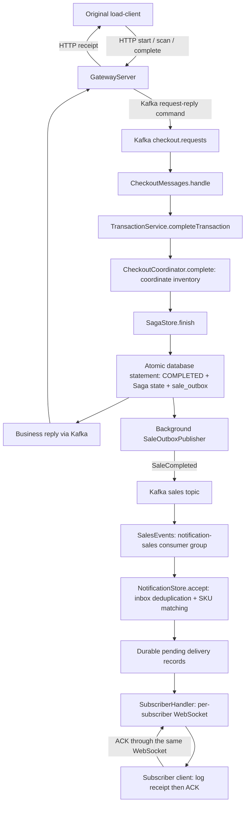

# Notification Service — Submission Report

## Video

[Watch the Notification Service demonstration on Panopto](https://northeastern.hosted.panopto.com/Panopto/Pages/Viewer.aspx?id=d9df3ffb-0ff4-4167-bb20-b50b00a1ea41). The URL was supplied by the author; instructor playback permissions have not been independently verified.

## Design and requirements

This implementation extends the event-driven supermarket system. The original load-client sends HTTP requests to the Gateway, which uses Kafka request–reply commands to reach Checkout. Successful checkout atomically records transaction completion and a `SaleCompleted` event in a PostgreSQL transactional outbox. A background publisher sends this event to the Kafka sales topic. Scanning alone does not create a completed-sale notification.

The Notification Service supports up to 100 registered subscribers, each subscribing to one or more SKUs. It persists subscriptions, consumes sales through a dedicated consumer group, deduplicates events in a durable inbox, and matches sold SKUs to subscriptions eligible at the sale completion time. Each matching transaction/subscriber/SKU has a delivery record carrying the sold quantity. Shared immutable sale-item payloads avoid duplicating the full payload for every recipient.

A configurable subscriber application runs one thread and one WebSocket connection per subscriber. All connections use `/notifications`, but each connection is bound to its own subscriber identity and receives only its pending notifications. The client logs receipts, flushes its buffer, and sends acknowledgements. Unacknowledged notifications remain retryable; replayed notification IDs are deduplicated in client logs. This is at-least-once delivery with deduplication, not exactly-once network delivery. Buffered log flush is not an explicit disk fsync or a guarantee against arbitrary machine power loss.

Key implementation files, relative to the project root:

- `gateway/src/main/java/edu/cs6510/servicebased/gateway/GatewayServer.java`
- `checkout-service/src/main/java/edu/cs6510/servicebased/checkout/persistence/SagaStore.java`
- `checkout-service/src/main/java/edu/cs6510/servicebased/checkout/SaleOutboxPublisher.java`
- `notification-service/src/main/java/edu/cs6510/notification/NotificationStore.java`
- `notification-service/src/main/java/edu/cs6510/notification/SalesEvents.java`
- `notification-service/src/main/java/edu/cs6510/notification/SubscriberHandler.java`
- `subscriber-client/src/main/java/edu/cs6510/subscriber/SubscriberMain.java`
- `scripts/verify_notifications.py`

## End-to-end architecture and message flow



The first Kafka path is **request–reply**: the Gateway waits for Checkout's business response. The second is **asynchronous publish–subscribe**: checkout does not wait for external notification receipt. Both use Kafka, but their interaction semantics differ. Background outbox publication starts after the database commit and may overlap with the HTTP response returning. Kafka broker acknowledgement is not subscriber acknowledgement.

The scan path is separate: a `SCAN_ITEM` command updates the basket and scan outbox; background scan events feed Analytics. A scan does not prove a sale. The completed basket's SKU quantities, rather than the analytics sliding window, are the input to this notification design. Checkout's scheduled Saga recovery runs internally and does not require a new Gateway request.

The excerpts below are focused portions of the implementation, not standalone compilable methods. Links are relative to this report and point to the same repository branch.

## Requirement-by-requirement implementation

### 1. Support up to 100 users

**Design:** enforce a registered-subscriber capacity in the service, not just in the test client. Existing subscribers can reconnect without consuming another registration. Registration runs in a database transaction and takes an advisory lock before checking capacity, preventing concurrent new registrations from racing past the limit.

**Code:** [NotificationStore constructor](../../notification-service/src/main/java/edu/cs6510/notification/NotificationStore.java#L39), [subscribe](../../notification-service/src/main/java/edu/cs6510/notification/NotificationStore.java#L59), and [configuration](../../notification-service/src/main/resources/application.properties).

```java
@Value("${notification.max-users:100}") int maxUsers
```

```java
jdbc.execute("SELECT pg_advisory_xact_lock(6510, 20)");
```

```java
if (jdbc.queryForObject("SELECT count(*) FROM subscribers", Long.class) >= maxUsers)
    throw new IllegalArgumentException("Subscriber capacity reached");
```

The constructor rejects configured limits outside 1–100. The subscriber application independently validates its requested thread count. The completed reports record 100 subscribers and 100 connected users at the final snapshot. This demonstrates the tested capacity, not unlimited registration or connection scaling.

### 2. Subscribe to one or more SKUs

**Design:** a client sends a WebSocket `SUBSCRIBE` message containing its ID, token and SKU list. The service rejects null/empty lists and malformed entries, hashes the token, and stores subscriber-to-SKU relationships. `TreeSet` removes duplicate SKUs. Existing users must reconnect with the same credentials and SKU set; subscription editing is outside this implementation's scope.

**Code:** [NotificationStore.subscribe](../../notification-service/src/main/java/edu/cs6510/notification/NotificationStore.java#L59) and [SubscriberMain WebSocket subscription](../../subscriber-client/src/main/java/edu/cs6510/subscriber/SubscriberMain.java#L125).

```java
jdbc.update("INSERT INTO subscribers(subscriber_id,token_hash) VALUES (?,?)", subscriberId, hashed);
jdbc.batchUpdate("INSERT INTO subscriptions(subscriber_id,sku) VALUES (?,?)",
        new TreeSet<>(skus).stream().map(sku -> new Object[]{subscriberId, sku}).toList());
```

`subscribe(...)` defines who is interested in which products; it does not process a sale or send a sales notification. For example, a producer subscribed to SKU-A and SKU-B receives no notification for a sale containing only SKU-C.

### 3. Self-checkout pushes sales information

**Design:** preserve the original event-driven entry path, then add a durable completed-sale pipeline. The [Gateway](../../gateway/src/main/java/edu/cs6510/servicebased/gateway/GatewayServer.java#L227) sends:

```java
return relay(bus.request("checkout", "COMPLETE_TRANSACTION", transactionId, "{}"));
```

[CheckoutMessages](../../checkout-service/src/main/java/edu/cs6510/servicebased/checkout/CheckoutMessages.java) dispatches to `TransactionService.completeTransaction(...)`, which delegates to [CheckoutCoordinator](../../checkout-service/src/main/java/edu/cs6510/servicebased/checkout/CheckoutCoordinator.java). After inventory coordination, [SagaStore.finish](../../checkout-service/src/main/java/edu/cs6510/servicebased/checkout/persistence/SagaStore.java#L113) atomically updates the transaction and Saga and inserts a sale event:

```sql
INSERT INTO sale_outbox(transaction_id,payload)
SELECT changed.transaction_id,jsonb_build_object(
 'schemaVersion',1,'eventId',gen_random_uuid()::text,
 'transactionId',changed.transaction_id,'completedAt',changed.completed_at,
 'items',(SELECT jsonb_agg(jsonb_build_object('sku',sku,'quantity',quantity) ORDER BY sku)
          FROM transaction_items WHERE transaction_id=changed.transaction_id))
FROM changed WHERE changed.completed_at IS NOT NULL
ON CONFLICT(transaction_id) DO NOTHING RETURNING transaction_id
```

The [outbox schema](../../checkout-service/database/006-sale-outbox.sql) uses `transaction_id` as its primary key. [SaleOutboxPublisher.publishOnce](../../checkout-service/src/main/java/edu/cs6510/servicebased/checkout/SaleOutboxPublisher.java#L22) reads unprocessed rows and calls:

```java
bus.publish(bus.topic("sales"), record[0], record[1]);
```

It marks the row processed only after publication succeeds. [KafkaBus](../../event-messaging/src/main/java/edu/cs6510/events/KafkaBus.java) implements publication and request–reply transport; [SaleCompleted](../../event-messaging/src/main/java/edu/cs6510/events/SaleCompleted.java) defines the sales-event model. The transactional outbox avoids losing the event between checkout completion and publication. A crash after broker acceptance but before marking the row can cause replay, which the consumer must tolerate.

### 4. Match sales to subscriptions and create the appropriate notifications

**Design:** [SalesEvents](../../notification-service/src/main/java/edu/cs6510/notification/SalesEvents.java#L36) subscribes to completed sales:

```java
bus.subscribe(bus.topic("sales"), "notification-sales", this::accept);
```

It passes bounded batches to [NotificationStore.accept](../../notification-service/src/main/java/edu/cs6510/notification/NotificationStore.java#L94). In one database transaction, this method validates events, inserts them into `sale_inbox`, checks conflicting replays, stores new sale items, and creates matching deliveries. Only newly inserted events generate delivery rows.

```sql
INSERT INTO notification_deliveries(item_id,subscriber_id)
SELECT item.item_id,s.subscriber_id FROM items item
JOIN subscriptions s ON s.sku=item.sku JOIN subscribers u USING(subscriber_id)
WHERE u.subscribed_at<=item.completed_at
ORDER BY s.subscriber_id,item.event_id,item.sku
```

The SKU join performs routing; the timestamp condition prevents a later subscription from receiving an earlier sale. One logical notification corresponds to a transaction, subscriber and sold SKU. Three units of the same SKU are represented by `quantity: 3`, not necessarily three messages. `accept(...)` creates pending records; separate dispatch workers send them. [Database schema](../../notification-service/database/schema.sql) separates immutable sale-item payloads from mutable subscriber delivery state.

### 5. Configurable subscriber threads and receipt logging

**Design:** the original load-client generates shopping transactions; the separate subscriber-client simulates product producers receiving notifications. They have different responsibilities. [SubscriberMain](../../subscriber-client/src/main/java/edu/cs6510/subscriber/SubscriberMain.java#L19) parses `--subscribers`, `--skus`, `--url`, `--seconds`, `--prefix`, and `--output`.

```java
int count = Integer.parseInt(values.getOrDefault("--subscribers", "10"));
```

For each subscriber it creates a named platform thread that invokes `runSubscriber(...)`. Each maintains its own connection, subscription file, token file, receipt log and deduplication state. In the benchmark client, even-numbered users follow all supplied SKUs and odd-numbered users follow one, testing both subscription shapes and creating heavy fan-out.

[ReceiptBatch](../../subscriber-client/src/main/java/edu/cs6510/subscriber/ReceiptBatch.java#L36) records `receivedAt` alongside sale and notification fields. It flushes the log buffer before sending batched ACKs. Reconnecting clients reload previously logged notification IDs to avoid duplicate log entries. Real subscriber tokens and bulk receipt logs are not included in the public submission.

### 6. Independent communication channels

**Design:** [WebSocketConfig](../../notification-service/src/main/java/edu/cs6510/notification/WebSocketConfig.java#L20) registers a shared endpoint:

```java
registry.addHandler(handler, "/notifications");
```

Each subscriber independently calls `buildAsync(options.url(), listener)` in [SubscriberMain](../../subscriber-client/src/main/java/edu/cs6510/subscriber/SubscriberMain.java#L127). Sharing a URL or HttpClient does not share a WebSocket connection.

[SubscriberHandler](../../notification-service/src/main/java/edu/cs6510/notification/SubscriberHandler.java#L60) creates a `Connection` per session and starts its dispatch task:

```java
var connection = new Connection(session);
connections.put(session.getId(), connection);
senders.submit(() -> dispatch(connection));
```

After validating `SUBSCRIBE`, it binds the connection to `subscriberId`. Its in-memory active-user map prevents two simultaneous channels for the same user within this service instance. [NotificationStore.pending](../../notification-service/src/main/java/edu/cs6510/notification/NotificationStore.java#L239) selects only eligible records for that user:

```sql
WHERE subscriber_id=? AND acknowledged_at IS NULL AND next_attempt_at<=now()
```

The handler sends those records on that user's connection, individually or in batches, and processes ACKs from that channel. Kafka provides asynchronous service-to-service messaging; WebSocket sessions provide independent client channels. Neither is a guarantee of independent physical CPU or disk resources.

## Demonstration, correctness and performance evidence map

| Assignment evidence | Implementation or report to show | Interpretation |
| --- | --- | --- |
| Real sales generated by the original client | [Harness](../../scripts/test-notifications.py), [default client report](report-default.json), [stress client report](report-stress.json) | START, SCAN and COMPLETE operation counts/errors; workload configuration and TPS |
| Independent notification correctness | [Verifier](../../scripts/verify_notifications.py#L17), [default verification](correctness-default.json), [stress verification](correctness-stress.json) | Compute expectations from completed checkout data and subscriptions, then compare subscriber logs |
| Duplicate, missing and incorrect delivery checks | [Verifier comparisons](../../scripts/verify_notifications.py#L44) | Check `(transactionId, subscriberId, SKU)` and quantity rather than only total counts |
| Recovery and replay | [Harness checks](../../scripts/test-notifications.py#L273), verification `checks` arrays | Scan without sale, repeated completion, offline delivery, service restart, outbox replay |
| End-to-end notification latency | [Latency calculation](../../scripts/verify_notifications.py#L55), verification `latency_ms` | `receivedAt - completedAt`; includes queueing, ingestion and transmission, not just network latency |
| Checkout performance | Client `transactionsPerSecond`, `itemsPerSecond`, operation `meanMs`, `p50Ms`, `p95Ms`, `p99Ms` and errors | Distinguish whole-basket TPS from the duration of one Complete HTTP request |
| Backlog and connection state | [StatusController](../../notification-service/src/main/java/edu/cs6510/notification/StatusController.java), final verification `metrics` | Pending, sales, notifications, send attempts and connected users; attempts are not proof of receipt |
| Database and stage bottlenecks | [Metrics helpers](../../scripts/notification_metrics.py), [stage diagnostics](../../scripts/stage_diagnostics.py), [retained validation snapshots](validation.json) | I/O and optional stage timings help investigate queueing; do not claim a specific bottleneck from final counts alone |
| Environmental comparability | [Captured environment](environment.json), verification `power_conditions` | Record source/configuration and power differences; performance-safety pass does not make environments identical |

The video linked above is the assignment deliverable. A roughly five-minute walkthrough should identify the base architecture, explain the six requirements, show an actual running-system segment with subscriber readiness and received messages, and then show the completed validation reports. Waiting periods may be edited out explicitly. A short live demonstration and a previously completed stress report must be clearly distinguished; an archived report alone is not live execution. The report does not independently certify the video's content or viewing permissions.

## Completed benchmark results

Both runs used the original load-client, baskets of 1–20 scanned items, and 100 notification subscribers. Default means 10 checkout stations for 60 seconds; stress means 100 stations for 120 seconds. It does not mean the harness's no-argument defaults.

| Metric | Default | Stress |
| --- | ---: | ---: |
| Load-client completed transactions | 5,330 | 24,955 |
| Load wall time (seconds) | 60.078516333 | 120.568560833 |
| Transactions per second | 88.71723746400725 | 206.9776716881051 |
| Scanned items | 56,391 | 263,832 |
| HTTP operation errors | 0 | 0 |
| Completed sales including functional probes | 5,332 | 24,957 |
| Expected notifications | 2,524,798 | 11,785,116 |
| Received notifications | 2,524,798 | 11,785,116 |
| Missing / unexpected / wrong quantity / duplicate log entries | 0 / 0 / 0 / 0 | 0 / 0 / 0 / 0 |
| Notification P50 (seconds) | 147.55280 | 293.60491 |
| Notification P95 (seconds) | 238.07526 | 431.19620 |
| Notification P99 (seconds) | 242.14769 | 461.39524 |
| Complete HTTP request P95 (milliseconds) | 42.506417 | 58.202334 |
| Final pending notifications | 0 | 0 |
| Load / notification / metrics audit passed | true / true / true | true / true / true |
| Recorded load/drain/replay/validation interval (seconds) | 352.54 | 711.13 |
| Power source | AC Power | Battery Power |
| Low-power mode | off | off |

The two additional completed sales are functional-test transactions, not duplicate load-client sales. The notification latency is `receivedAt - completedAt`, including queueing across the full event-to-client path. It is distinct from the Complete HTTP request latency. The recorded elapsed interval includes replay and verification work, not only backlog draining.

## Correctness validation

The verifier independently joins completed Checkout transactions and quantities with persisted subscriptions and subscription times. It compares expected `(transactionId, subscriberId, SKU)` records against subscriber JSONL logs, checking missing, unexpected, duplicate records and quantity mismatches. Metrics are independently audited against database state.

Both completed runs passed scan-without-sale, repeated-completion, offline-delivery, Notification service restart, outbox replay, and original-load-client checks. The final pending count was zero with 100 connected subscribers. These are results of these particular runs, not an unlimited-scale guarantee.

## Environment and limitations

All components ran on one Mac. Five separate PostgreSQL instances still shared the machine's CPU, memory and storage with Kafka, Java services, load-client and subscriber-client. The catalog contained 2,000 SKUs, seeded with 1,000,000 units per SKU to avoid stock exhaustion during the benchmark. Fifty subscribers followed all supplied SKUs; fifty followed one SKU each, creating a deliberately heavy notification fan-out.

JVM options were `-Xms64m -Xmx256m -XX:TieredStopAtLevel=1`. Delivery batch size was 512, ingestion batch size 16, dispatch database concurrency 1, payload cache size 0 and ACK-drain-at-gate false. Additional database and application settings are preserved in `environment.json`.

Both runs passed the harness performance-safety checks, but default was on AC power and stress on battery. Captured load-client source hashes match across the runs; captured application source hashes do not all match. Their per-run hashes and differing paths are preserved in `environment.json`. These runs are individual workload measurements, not a controlled scaling experiment or proof of an optimization speedup. No claim is made that the source differences are behaviorally irrelevant without a historical-content comparison.

The runs demonstrate correct eventual delivery, but not low-latency delivery under heavy load. Default P95 was approximately 238 seconds and stress P95 approximately 431 seconds. High fan-out and shared resources are plausible contributors; identifying the dominant bottleneck requires profiling. The assignment specifies performance measurement but gives no numerical notification latency target. Earlier disk-exhausted runs are not presented as passed tests. No AWS or Explorer deployment is claimed.

## Reproduction

Run from the project root with adequate free disk space and no conflicting test processes. Space must be budgeted for millions of delivery records and receipt logs; the startup minimum is not a full-run capacity guarantee.

```bash
caffeinate -i -s env \
  NOTIFICATION_ACK_DRAIN_AT_GATE=false \
  NOTIFICATION_PAYLOAD_CACHE_SIZE=0 \
  python3 scripts/test-notifications.py \
  --variant notification --subscribers 100 \
  --stations 10 --duration 60 --min-items 1 --max-items 20 \
  --database-servers separate --drain-timeout 600
```

For stress, change only `--stations 100 --duration 120`. Wait for final notification validation, not just the load-client throughput output. The 600-second limit applies to relevant wait phases, not to total program runtime.

## Evidence

- `report-default.json` and `report-stress.json`: byte-for-byte original client JSON outputs.
- `correctness-default.json` and `correctness-stress.json`: byte-for-byte completed harness verification outputs.
- `environment.json`: per-run captured settings and source hashes, with source-hash differences identified.
- `validation.json`: automated consistency checks, SHA-256 evidence hashes, run identifiers and retained diagnostic snapshots.

Local raw runs are `target/notification-test-a736b26880` (default) and `target/notification-test-15b1c6775d` (stress). Raw logs and database data are intentionally not committed. Subscriber credentials, tokens, video binaries and private keys are excluded from this evidence submission.
